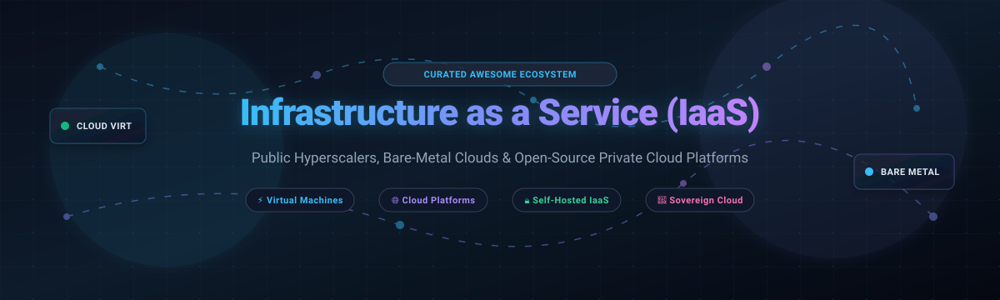

# Awesome-Infrastructure-As-A-Service-IAAS 🚀☁️

  

 

### 🌟 Curated Directory of Cloud IaaS Platforms, Virtualization Hypervisors & Self-Hosted Sovereign Cloud Stacks

*A comprehensive landscape guide to hyperscalers, bare-metal public clouds, microVM runtimes, container-native virtualization, and open-source enterprise private cloud orchestrators.*

**📅 Last updated: October 2026**

---

## 📖 Table of Contents

- [🌐 Sector Overview & Market Dynamics](#-sector-overview--market-dynamics)
- [🏢 SaaS & Hosted Cloud Platforms](#-saas--hosted-cloud-platforms)
- [💻 Open-Source GitHub Projects](#-open-source-github-projects)
- [🤝 How to Contribute](#-how-to-contribute)
- [💖 Support & Sponsorship](#-support--sponsorship)
- [⭐ Star History](#-star-history)
- [⚠️ Disclaimer](#-disclaimer)

---

## 🌐 Sector Overview & Market Dynamics

The worldwide **Infrastructure-as-a-Service (IaaS)** market is estimated to reach approximately **$287 billion by 2026** (up from ~$172 billion in 2024), driven largely by accelerated enterprise cloud-native modernization and unprecedented demand for AI-optimized compute infrastructure. 

Market dynamics are **heavily concentrated at the top**—where the top 5 hyperscale cloud providers account for roughly **82%** of global spend in a winner-takes-most structure—coexisting alongside a rapidly expanding, fragmented layer of specialized neoclouds, GPU cloud providers, and European sovereign infrastructure platforms.

---

## 🏢 SaaS & Hosted Cloud Platforms

| Platform | Company Valuation / Revenue | Starting Pricing Tier | Free Tier / Trial Limits | Description |
| :--- | :--- | :--- | :--- | :--- |
| **[Microsoft Azure Virtual Machines](https://azure.microsoft.com/en-us/products/virtual-machines)** | ~$3.1T Market Cap (Microsoft) | ~$0.0052/hr (~$3.80/month) for `B1ls` (1 vCPU, 0.5 GiB RAM) | 30-day free trial with $200 credit; plus 12 months free of 750 hrs/month of `B1s`, `B2pts v2`, and `B2ats v2` VMs, and 55+ always-free services | Azure's IaaS offering with strong Windows Server and Active Directory integration, hybrid cloud via Azure Arc, and enterprise governance through Azure Policy. Best for organizations already invested in the Microsoft ecosystem. |
| **[AWS EC2](https://aws.amazon.com/ec2/)** | ~$2.2T Market Cap (Amazon) | ~$0.0042/hr (~$3.07/month) for `t4g.nano` (2 vCPUs, 0.5 GiB RAM) | 12 months free tier with 750 hours/month of Linux and Windows `t2.micro` or `t3.micro` instances | The market-leading public cloud compute service. Broadest instance type selection (general purpose, compute optimized, memory optimized, GPU, ARM Graviton), global region coverage, and deep integration with the AWS ecosystem. |
| **[Google Compute Engine](https://cloud.google.com/compute)** | ~$2.1T Market Cap (Alphabet) | ~$0.0075/hr (~$5.48/month) for `e2-micro` (2 vCPUs, 1 GB RAM) | 90-day free trial with $300 credit; plus Always Free tier with 1 non-preemptible `e2-micro` VM per month in US regions and 30 GB standard persistent disk | GCP's VM service with custom machine types, live migration, and sustained use discounts. Tight integration with BigQuery, GKE, and Google's networking infrastructure. Best for GCP-native architectures. |
| **[Oracle Cloud Infrastructure (OCI)](https://www.oracle.com/cloud/)** | ~$480B Market Cap (Oracle) | ~$0.0107/hr (~$7.81/month) for `VM.Standard.E5.Flex` (1 OCPU, 1 GB RAM) | 30-day free trial with $300 credit; plus Always Free tier of up to 4 Ampere A1 ARM compute cores & 24 GB RAM (usable as up to 4 VMs) and 2 AMD-based `VM.Standard.E2.1.Micro` instances | Oracle's cloud with competitive pricing for compute and strong database integration (Autonomous Database, Exadata). Generous Always Free tier. Best for Oracle database workloads and cost-sensitive general compute. |
| **[DigitalOcean Droplets](https://www.digitalocean.com/products/droplets)** | ~$11B Market Cap | $4.00/month ($0.00595/hr) for Basic Droplet (1 vCPU, 512 MB RAM, 10 GB SSD, 500 GB transfer) | 60-day free trial with $200 platform credit for new accounts across compute, managed databases, and storage | Developer-friendly cloud with simple pricing, predictable bandwidth allowances, and a clean UI. Best for small teams, startups, and developers who want straightforward VMs without hyperscaler complexity. |
| **[Vultr](https://www.vultr.com/)** | $3.5B Valuation (The Constant Company) | $2.50/month ($0.004/hr) for Cloud Compute IPv6-only (1 vCPU, 0.5 GB RAM, 10 GB SSD, 0.5 TB transfer; $3.50/mo with IPv4) | 30-day free trial credit of up to $200–$300 (via promotional onboarding); plus approval-based Free Tier program for eligible developers | Independent cloud with global region coverage, high-frequency compute options, and bare metal availability. Best for teams seeking an alternative to the hyperscalers with broad geographic reach. |
| **[OVHcloud](https://www.ovhcloud.com/)** | ~€2.2B Market Cap (~$2.5B) | ~$0.012/hr (~$7.00/month) for `d2-2` Discovery instance (1 vCore, 2 GB RAM, 25 GB SSD) | 30-day Public Cloud free trial with $200 / €200 credit for new accounts to test instances, object storage, and databases | European cloud provider with dedicated servers, public cloud instances, and private cloud options. Strong on data sovereignty and GDPR compliance. Best for European organizations requiring local infrastructure. |
| **[Hetzner Cloud](https://www.hetzner.com/cloud)** | ~€500M–€600M Annual Revenue (Est.) | €5.49/month (~€0.0088/hr) for `CX23` (2 vCPUs, 4 GB RAM, 40 GB NVMe) or €6.49/month for `CAX11` ARM | No permanent free tier; 14-day promotional sign-up vouchers (€20–€50 credit) available via partner campaigns | European cloud provider with exceptionally low pricing for dedicated-vCPU and shared-vCPU instances. Data centers in Germany, Finland, and the US. Best for cost-sensitive workloads requiring European data residency. |
| **[Scaleway](https://www.scaleway.com/)** | ~€100M–€200M Annual Revenue (Iliad Group) | €0.0006/hr (~€0.44/month) for `STARDUST1-S` (1 vCPU, 1 GB RAM, 10 GB SSD; IPv4 adds ~€0.004/hr); €0.01428/hr (~€10.42/month) for `PLAY2-PICO` | 30-day promotional credits (typically €100 for verified business accounts); plus permanent monthly free tier allowances (75 GB object storage egress, 1M serverless function calls, 1M generative API tokens) | French cloud provider with GPU instances, ARM-based offerings (Ampere), and bare metal. Best for European teams needing GPU or ARM compute with EU data residency. |

---

## 💻 Open-Source GitHub Projects

Sorted in descending order by GitHub_Stars. Stars_Counts update dynamically via GitHub shields linking directly to each repository's stargazers.

- **[Firecracker](https://github.com/firecracker-microvm/firecracker)**   
  **Secure and ultra-fast microVMs for serverless computing and multi-tenant IaaS.** Developed by Amazon Web Services in Rust and open-sourced under Apache 2.0, Firecracker runs on KVM to spin up lightweight virtual machines in as little as 5 milliseconds with minimal memory overhead (<5 MiB). Serves as the high-density isolation backbone behind AWS Lambda, AWS Fargate, and modern serverless platforms.

- **[KubeVirt](https://github.com/kubevirt/kubevirt)**   
  **Kubernetes-native virtualization technology.** CNCF Graduated project that extends Kubernetes via Custom Resource Definitions (CRDs) to orchestrate traditional virtual machines side-by-side with container workloads on the same cluster substrate. Bridges the architectural gap between legacy VM monoliths and cloud-native containerized microservices.

- **[Incus](https://github.com/lxc/incus)**   
  **The community-governed successor to LXD.** Born from Canonical's decision to take LXD in-house and relicense it to AGPLv3, Incus is a direct fork maintained under the Linux Containers (LXC) project under Apache 2.0. Manages both system containers and full QEMU-based virtual machines through a unified REST API and CLI with native OCI image support, OpenFGA/OIDC identity integrations, and live resource hot-plugging.

- **[Harvester](https://github.com/harvester/harvester)**   
  **Open-source enterprise hyperconverged infrastructure (HCI).** Built by SUSE Rancher, Harvester brings together KubeVirt, KVM, and Longhorn distributed block storage into a turnkey, bare-metal appliance. Designed as an open-source, operator-friendly alternative to VMware vSphere and Nutanix for private cloud edge and datacenter infrastructure.

- **[LXD](https://github.com/canonical/lxd)**   
  **Next-generation system container and virtual machine manager by Canonical.** Provides a cloud-like user experience for managing system containers (LXC) and full virtual machines (QEMU) with built-in image management, clustering, storage pools (ZFS, Btrfs, Ceph, LVM), and network integration with OVN.

- **[OpenStack (Nova)](https://github.com/openstack/nova)**   
  **The enterprise open-source IaaS standard.** Nova is the core compute service within the broader OpenStack ecosystem, coordinating VM lifecycle, scheduling, and placement across thousands of hypervisor nodes. The OpenStack platform integrates Keystone (identity), Neutron (software-defined networking), Cinder (block storage), and Glance (images) for massive telecom, enterprise, and sovereign cloud deployments.

- **[Apache CloudStack](https://github.com/apache/cloudstack)**   
  **Mature enterprise cloud orchestrator with streamlined operations.** An Apache Top-Level Project since 2013, CloudStack offers a turnkey turnkey IaaS management engine with an all-in-one management server architecture. Supports KVM, VMware vSphere, XenServer/XCP-ng, and Proxmox VE, offering multi-zone orchestration, automated VPC networking, and built-in CloudStack Kubernetes Service (CKS).

- **[Mist](https://github.com/mistio/mist-ce)**   
  **Open-source multicloud management and IaaS abstraction platform.** Provides a unified web interface, REST API, and CLI to orchestrate, automate, and monitor virtual machines, bare metal servers, and container clusters across diverse clouds (AWS, GCP, Azure, DigitalOcean, Hetzner, OpenStack, and KVM).

- **[OpenNebula](https://github.com/OpenNebula/one)**   
  **Open-source cloud and edge computing platform specialized in VMware migration.** Features AI-powered OneDRS dynamic scheduling, NetApp and Veeam integrations, and native support for GPU pass-through/vGPU with AI inference appliances (Ray + vLLM). Excels at transforming existing virtualization infrastructure into agile, self-service private and hybrid clouds.

- **[Xen Orchestra](https://github.com/vatesfr/xen-orchestra)**   
  **Turnkey web management, backup, and orchestration solution for XCP-ng and XenServer.** Provides an agentless administration UI, continuous replication, incremental delta backups, live migration, and self-service cloud provisioning for open-source Xen-based virtualization clusters.

- **[oVirt Engine](https://github.com/oVirt/ovirt-engine)**   
  **Feature-rich virtualization management platform built on KVM.** Originating as the upstream codebase for Red Hat Virtualization (RHV), oVirt provides enterprise storage domains (NFS, iSCSI, Fibre Channel, GlusterFS), high availability, live migration, and fine-grained role-based access control.

- **[Ganeti](https://github.com/ganeti/ganeti)**   
  **Lightweight cluster virtual server management tool.** Developed and utilized extensively within Google for commodity hardware clustering, Ganeti automates VM failover, replication, and disaster recovery using KVM or Xen hypervisors along with DRBD or shared networked storage.

- **[Proxmox VE Manager](https://github.com/proxmox/pve-manager)**   
  **The homelab, SMB, and self-hoster favorite for bare-metal virtualization.** Open-source virtualization platform combining KVM for VMs and LXC for lightweight system containers. Built on Debian with integrated web-based GUI, software-defined networking (SDN fabrics), ZFS storage with live RAIDZ expansion, Proxmox Backup Server integration, and high availability clustering.

---

## 🤝 How to Contribute

We welcome community contributions! To add a new platform or update existing details:

1. 🍴 **Fork the repository**.
2. 📝 **Edit or add entries** in `README.md` following the established tabular or list format.
3. 🔍 Ensure pricing, free tiers, and links are verified against official documentation.
4. 🚀 **Submit a Pull Request (PR)** with a clear explanation of your changes.

---

## 💖 Support & Sponsorship

If you find this repository valuable for evaluating cloud infrastructure, planning migrations, or building self-hosted private clouds, please consider supporting the project:

- ⭐ **Star this repository** to help others discover it.
- 🍴 **Fork & Share** with platform engineers, DevOps teams, and cloud architects.
- ☕ **Buy me a coffee / Sponsor**: Support ongoing maintenance, updates, and ecosystem research via the [GitHub Sponsor Dashboard](https://github.com/sponsors/ishandutta2007).

Your support is deeply appreciated and directly funds continued research into open-source cloud architectures!

---

## ⭐ Star History

---

## ⚠️ Disclaimer

- This is an independent, community-curated list compiled for educational and architectural reference purposes. Inclusion does not imply endorsement.
- **Operational complexity varies considerably**: Turnkey appliances like Proxmox VE can be provisioned in minutes, whereas enterprise frameworks like OpenStack require experienced platform engineering teams.
- **Licensing matters**: Licenses range from Apache 2.0 (Nova, CloudStack, Incus, Firecracker) to AGPLv3 (Proxmox components, LXD). Always verify licensing compliance for your organization.

---

**Made with ❤️ for cloud architects, platform engineers, and developers building sovereign infrastructure.**

